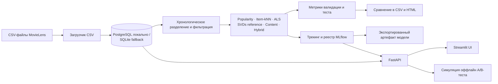

# MovieLens 25M Recommender System

Воспроизводимая рекомендательная система на основе классического машинного обучения, построенная на датасете MovieLens 25M. Проект включает хронологический пайплайн оффлайн-оценки, трекинг экспериментов и реестр моделей MLflow, REST API на FastAPI, пользовательский интерфейс на Streamlit и модуль симуляции оффлайн A/B-тестирования. Нейросетевые модели в данном проекте не используются.

## Оглавление

- [Архитектура и принцип работы](#архитектура-и-принцип-работы)
- [Технологический стек](#технологический-стек)
- [Структура проекта](#структура-проекта)
- [Требования](#требования)
- [Настройка окружения (WSL / Ubuntu)](#настройка-окружения-wsl--ubuntu)
- [Локальный запуск и использование](#локальный-запуск-и-использование)
- [Модели и алгоритмы](#модели-и-алгоритмы)
- [Конфигурация](#конфигурация)
- [Зафиксированные оффлайн-результаты](#зафиксированные-оффлайн-результаты)
- [Модуль оффлайн A/B-тестирования](#модуль-оффлайн-ab-тестирования)
- [API и веб-интерфейс](#api-и-веб-интерфейс)
- [Тестирование](#тестирование)
- [CI/CD Workflow](#cicd-workflow)
- [Ограничения и известные проблемы](#ограничения-и-известные-проблемы)

## Архитектура и принцип работы

Проект реализует полный цикл работы рекомендательной системы: от загрузки исходных данных и их фильтрации до развертывания API и веб-интерфейса.



### Основные этапы обработки данных и обучения

1. **Загрузка данных:** Сырые CSV-файлы MovieLens подготавливаются и загружаются в база данных (PostgreSQL или SQLite) с помощью Alembic-миграций.
2. **Фильтрация и хронологическое разделение:** Данные фильтруются по минимальному количеству оценок для пользователей и фильмов (по умолчанию не менее 5 оценок). Разделение на обучающую (80%), валидационную (10%) и тестовую (10%) выборки выполняется строго по временной метке (timestamp), что предотвращает утечку данных из будущего (data leakage).
3. **Обучение и валидация:** Модели обучаются последовательно. Подбор гиперпараметров гибридной модели осуществляется на валидационной выборке по метрике NDCG@10.
4. **Регистрация моделей:** Каждая модель сохраняет метрики и артефакты в MLflow. Лучшая модель регистрируется в MLflow Model Registry и экспортируется в каталог `outputs/best_model/model/`.
5. **Сервинг:** FastAPI загружает экспортированные модели из MLflow и предоставляет REST API для выдачи рекомендаций и поиска похожих фильмов. Streamlit взаимодействует с FastAPI и MLflow для визуализации рекомендаций и метрик.

## Технологический стек

- **Язык программирования:** Python 3.13
- **Управление зависимостями и окружением:** `uv`, `setuptools`
- **Базы данных и ORM:** PostgreSQL, SQLite, SQLAlchemy 2.0, Alembic
- **Машинное обучение и математика:** NumPy, Pandas, SciPy, Scikit-learn
- **Трекинг экспериментов:** MLflow 2.18
- **API и веб-сервисы:** FastAPI, Uvicorn, Starlette
- **Интерфейс пользователя:** Streamlit, Plotly
- **Контейнеризация и оркестрация:** Docker, Docker Compose
- **Качество кода и тестирование:** Pytest, Ruff, Black, Pre-commit

## Структура проекта

```
.
├── .github/
│   └── workflows/
│       └── ci.yml               # Конфигурация GitHub Actions CI
├── configs/                     # Конфигурационные файлы YAML
│   ├── data.yaml                # Параметры данных, путей и разделения
│   ├── experiments.yaml         # Настройки метрик оценки и A/B-тестов
│   └── models.yaml              # Гиперпараметры алгоритмов рекомендаций
├── data/                        # Каталог данных MovieLens (игнорируется Git)
│   └── README.txt
├── docs/                        # Дополнительная техническая документация
│   ├── ab_testing.md            # Подробное описание модуля A/B-тестирования
│   └── api.md                   # Документация REST API и Streamlit UI
├── migrations/                  # Миграции структуры БД (Alembic)
│   ├── env.py
│   └── versions/
├── notebooks/                   # Jupyter Notebooks для экспериментов
│   └── colab_full_run.ipynb     # Ноутбук для полного запуска в Google Colab
├── outputs/                     # Результаты обучения, экспортированные модели и отчеты
│   ├── best_model_evaluation.json
│   ├── model_metrics.csv
│   └── model_metrics.html
├── src/                         # Исходный код пакета recsys
│   └── recsys/
│       ├── ab/                  # Модуль оффлайн A/B-симуляции и статистических тестов
│       ├── api/                 # REST API на FastAPI
│       ├── data/                # Загрузка и хронологическая разбивка данных
│       ├── db/                  # SQLAlchemy модели и подключение к БД
│       ├── evaluation/          # Вычисление ранжирующих метрик и проверка моделей
│       ├── features/            # Извлечение и подготовка признаков
│       ├── models/              # Реализации алгоритмов рекомендаций
│       ├── ui/                  # Веб-интерфейс на Streamlit
│       └── training.py          # Основной скрипт пайплайна обучения
├── tests/                       # Набор модульных и интеграционных тестов
├── Alembic.ini                  # Конфигурация Alembic
├── Dockerfile                   # Образ для развертывания сервисов
├── Makefile                     # Команды автоматизации сборки и запуска
├── docker-compose.yml           # Конфигурация PostgreSQL, MLflow, API и UI
└── pyproject.toml               # Конфигурация проекта, зависимостей и линтеров
```

## Требования

- Python 3.13
- Менеджер пакетов [`uv`](https://docs.astral.sh/uv/)
- Docker и Docker Compose (для локального стека PostgreSQL / MLflow / API / UI)
- Исходные CSV-файлы MovieLens 25M для полной загрузки и обучения

## Настройка окружения (WSL / Ubuntu)

Для работы под Ubuntu/WSL установите `uv` и создайте виртуальное окружение:

```bash
curl -LsSf https://astral.sh/uv/install.sh | sh
export PATH="$HOME/.local/bin:$HOME/.cargo/bin:$PATH"

uv python install 3.13
uv venv --python 3.13 .venv
source .venv/bin/activate
python --version
```

Убедитесь, что используется Python 3.13. Установите проект и зависимости разработки:

```bash
uv pip install -e ".[dev]"
```

Разместите шесть CSV-файлов MovieLens в каталоге `data/` (или задайте путь через переменную окружения `MOVIELENS_DATA_DIR`):
- `ratings.csv`
- `movies.csv`
- `tags.csv`
- `links.csv`
- `genome-scores.csv`
- `genome-tags.csv`

Сырые данные, сгенерированные базы данных, артефакты моделей и хранилище MLflow внесены в `.gitignore`.

## Локальный запуск и использование

### 1. Запуск инфраструктурных сервисов

Запустите сервисы PostgreSQL и MLflow в Docker Compose:

```bash
docker compose up -d postgres mlflow
```

### 2. Применение миграций и загрузка данных

Выполните команду для применения миграций Alembic и загрузки CSV-файлов в баз данных:

```bash
make load-data
```

### 3. Запуск обучения и оффлайн-оценки

Запустите полный пайплайн обучения моделей:

```bash
make train
```

Скрипт обучения зафиксирует метрики валидации и теста в MLflow, выберет лучшую модель по метрике `validation_ndcg_at_10`, зарегистрирует ее в MLflow Model Registry и экспортирует в `outputs/best_model/model/`.

#### Быстрая проверка (Smoke mode)

Для быстрой проверки работоспособности пайплайна без загрузки полного датасета используйте режим синтетического дымового тестирования:

```bash
python -m recsys.training \
  --data-config configs/data.yaml \
  --model-config configs/models.yaml \
  --experiment-config configs/experiments.yaml \
  --smoke
```

#### Проверка экспортированной модели

Для повторной оценки экспортированной модели на хронологической тестовой выборке и сравнения результатов с сохраненной таблицей метрик выполните:

```bash
python -m recsys.evaluation.best_model_check
```

Скрипт читает модель из `outputs/best_model/model/`, метрики из `outputs/model_metrics.csv` и исходные файлы из `data/`, а затем записывает итоговый отчет в `outputs/best_model_evaluation.json`.

### 4. Запуск полного стека (API и UI)

Соберите и запустите полный контейнеризованный стек сервисов:

```bash
docker compose up --build -d
```

После запуска будут доступны следующие сервисы:
- **FastAPI Swagger UI:** `http://localhost:8000/docs`
- **Streamlit UI:** `http://localhost:8501`
- **MLflow Tracking UI:** `http://localhost:5000`

## Модели и алгоритмы

В проекте реализованы 6 классических подходов к построению рекомендательных систем:

1. **Popularity (`recsys.models.popularity`):** Неперсонализированная baseline-модель, ранжирующая фильмы по количеству оценок сглаживанием Лапласа (параметр `smoothing: 10.0`).
2. **Item-kNN (`recsys.models.item_knn`):** Коллаборативная фильтрация на основе сходства предметов (Item-based Collaborative Filtering) с использованием косинусного расстояния между векторами оценок пользователей (`k_neighbors: 50`).
3. **ALS (`recsys.models.als`):** Метод чередующихся наименьших квадратов (Implicit Alternating Least Squares) для разложения разреженной матрицы взаимодействий (`factors: 32`, `regularization: 0.1`, `iterations: 8`).
4. **SVDs Reference (`recsys.models.svd`):** Модель на основе усеченного сигулярного разложения (Truncated SVD / Scikit-learn TruncatedSVD) матрицы оценок пользователей, используемая в качестве эталонного ориентира.
5. **Content-Based (`recsys.models.content_based`):** Контентная модель, формирующая текстовые TF-IDF векторы по жанрам и тегам фильмов с последующим уменьшением размерности через TruncatedSVD (`max_features: 20000`, `svd_components: 128`).
6. **Hybrid (`recsys.models.hybrid`):** Линейная комбинация предсказаний моделей ALS и Content-Based (`als_weight * score_als + content_weight * score_content`). Подбор весов выполняется на валидационной выборке.

## Конфигурация

Все ключевые параметры системы управляются через YAML-файлы в директории `configs/`:

### `configs/data.yaml`
- `raw_dir`: Относительный путь к каталогу с CSV-файлами (`../data`).
- `raw_dir_env`: Имя переменной окружения для переопределения пути (`MOVIELENS_DATA_DIR`).
- `split`: Доли хронологического разделения (`train_fraction: 0.8`, `validation_fraction: 0.1`, `test_fraction: 0.1`).
- `filtering`: Пороги фильтрации (`min_user_ratings: 5`, `min_movie_ratings: 5`).

### `configs/models.yaml`
- Настройки гиперпараметров для каждой модели (число факторов, соседей, вес гибридизации и т. д.).

### `configs/experiments.yaml`
- `evaluation`: Порог релевантности оценки (`relevance_rating_threshold: 4.0`), длина рекомендательного списка (`k: 10`), размер батча при оценке (`batch_size: 32`).
- `ab`: Настройки A/B-симуляции (имя эксперимента `recommendation-ranking-v1`, контрольная модель `popularity`, тестовая `hybrid`, MDE `0.02`, baseline CTR `0.1`, `alpha: 0.05`, `power: 0.8`).

## Зафиксированные оффлайн-результаты

Приведенные ниже данные взяты из сохраненного артефакта `outputs/model_metrics.csv`. Ранжирующие метрики посчитаны при $K=10$. Величина «NDCG gap» представляет собой разность между NDCG@10 на валидации и тесте, а «Drop» указывает относительное падение в процентах.

| Модель | Validation NDCG@10 | Test NDCG@10 | NDCG gap | Drop | Validation Recall@10 | Test Recall@10 | Validation MAP@10 | Test MAP@10 | Validation Precision@10 | Test Precision@10 |
|---|---:|---:|---:|---:|---:|---:|---:|---:|---:|---:|
| svds_reference | 0.1381 | 0.1058 | 0.0323 | 23.4% | 0.0586 | 0.0568 | 0.0753 | 0.0558 | 0.1186 | 0.0866 |
| hybrid | 0.1206 | 0.0908 | 0.0298 | 24.7% | 0.0526 | 0.0567 | 0.0603 | 0.0448 | 0.1020 | 0.0737 |
| item_knn | 0.1060 | 0.0845 | 0.0216 | 20.3% | 0.0423 | 0.0427 | 0.0555 | 0.0440 | 0.0937 | 0.0699 |
| popularity | 0.0755 | 0.0621 | 0.0134 | 17.8% | 0.0277 | 0.0308 | 0.0382 | 0.0311 | 0.0629 | 0.0502 |
| content_based | 0.0732 | 0.0535 | 0.0197 | 26.9% | 0.0357 | 0.0372 | 0.0309 | 0.0228 | 0.0700 | 0.0490 |
| als | 0.0004 | 0.0004 | -0.00002 | — | 0.0001 | 0.0001 | 0.0001 | 0.0001 | 0.0004 | 0.0004 |

Модель `svds_reference` показала наилучшие результаты по метрике NDCG@10 как на валидационной, так и на тестовой выборке.

## Модуль оффлайн A/B-тестирования

Модуль `recsys.ab` предназначен для **оффлайн-симуляции** эксперимента, а не для проведения живого A/B-теста на пользователях.

### Принцип работы симуляции
1. **Деление пользователей:** Хэширование пар `(user_id, experiment_name)` обеспечивает стабильное распределение пользователей между контрольной (Control) и тестовой (Treatment) группами.
2. **Прокси-клики:** Оценка пользователя в тестовом периоде, равная или превышающая порог `rating_click_threshold` (по умолчанию 4.0), трактуется как клик.
3. **Статистическая оценка:** Рассчитываются CTR групп, t-критерий Уэлча (Welch's t-test), критерий Манна-Уитни, а также доверительный интервал методом бутстрэпа (10,000 выборок).
4. **CUPED:** Для снижения дисперсии может применяться методика CUPED на основе предэкспериментальных оценок пользователя.
5. **A/A-тестирование:** Функция `aa_false_positive_rate` позволяет проверить корректность статистических критериев и уровень ложноположительных срабатываний (Type I error) на синтетических равных группах.

Для получения подробной информации см. [docs/ab_testing.md](docs/ab_testing.md).

## API и веб-интерфейс

### REST API (FastAPI)

API запускается командой `uvicorn recsys.api.app:app` и использует переменные окружения для подключения к БД и MLflow:

- `GET /recommend/{user_id}?k=10`: Определение группы A/B-теста для пользователя и выдача ранжированного списка рекомендаций с метаданными фильмов.
- `GET /similar/{movie_id}?k=10`: Поиск $K$ ближайших фильмов по модели Item-kNN.
- `GET /movies/{movie_id}`: Получение метаданных фильма из каталога.
- `POST /feedback`: Сохранение пользовательской оценки или клика в БД.
- `GET /experiments/{name}/results`: Получение сохраненных результатов A/B-симуляции из таблицы `experiments`.

### Веб-интерфейс (Streamlit)

Запускается командой `streamlit run src/recsys/ui/app.py`. Позволяет:
- Получать персонализированные рекомендации по `user_id`.
- Просматривать и сравнивать метрики моделей из MLflow.
- Анализировать результаты симуляции A/B-тестов.

Для получения подробной информации см. [docs/api.md](docs/api.md).

## Тестирование

Набор тестов проверяет корректность работы всех компонентов системы. Тесты запускаются с помощью `pytest`:

```bash
pytest
```

Основные тестовые модули в каталоге `tests/`:
- `test_data_loader.py`: Проверка корректности загрузки CSV и работы с БД.
- `test_data_processing.py`: Проверка хронологического разбиения и фильтрации.
- `test_models.py`: Модульные тесты для всех моделей (Popularity, Item-kNN, ALS, SVD, Content, Hybrid).
- `test_metrics.py`: Проверка расчета метрик NDCG, Recall, MAP, Precision, Coverage, Novelty, Popularity.
- `test_ab.py`: Тестирование функций A/B-симуляции, расчета размера выборки, CUPED и A/A-теста.
- `test_api.py`: Интеграционные тесты эндпоинтов FastAPI.
- `test_tracking.py`: Проверка логирования параметров, метрик и артефактов в MLflow.
- `test_ui.py`: Тестирование вспомогательных функций Streamlit UI.

## CI/CD Workflow

Автоматическое тестирование и проверки кода выполняются с помощью GitHub Actions. Конфигурация находится в файле `.github/workflows/ci.yml`.

### Этапы workflow (`test` job):
1. **Checkout:** Получение исходного кода репозитория (`actions/checkout@v4`).
2. **Setup Python:** Установка Python 3.13 с кэшированием pip-пакетов (`actions/setup-python@v5`).
3. **Install dependencies:** Установка проекта и dev-зависимостей (`python -m pip install -e ".[dev]"`).
4. **Run tests:** Запуск полного набора модульных тестов (`python -m pytest`).
5. **Linting and Formatting:** Проверка стиля кода с помощью Ruff и Black:
   - `ruff check .`
   - `ruff format --check .`
   - `black --check .`
6. **Docker Build:** Сборка Docker-образа приложения (`docker build --tag movielens-recsys:ci .`).

CI запускается при каждом пуше (`push`) и создании пулл-реквеста (`pull_request`).

## Ограничения и известные проблемы

- **Аномалия модели ALS:** В зафиксированных оффлайн-результатах показатель NDCG@10 для модели ALS составляет порядка 0.0004 на валидационной и тестовой выборках, а средняя популярность рекомендуемых фильмов — около 42 оценок. Причина низкого качества предсказаний ALS находится на стадии исследования. Модель ALS и гибридную модель следует считать невалидными до устранения данной проблемы.
- **Оффлайн-метрики как прокси:** Оффлайн-метрики базируются на исторических оценках и не отображают реального поведения пользователей в онлайн-среде.
- **Ограничения A/B-симуляции:** Оффлайн A/B-тест использует порог оценки как прокси-клик и не моделирует реальное показы рекомендаций.
- **Требования к памяти:** Обучение на полном датасете MovieLens 25M и вычисление метрик требуют достаточного объема оперативной памяти (рекомендуется от 16 ГБ RAM).
