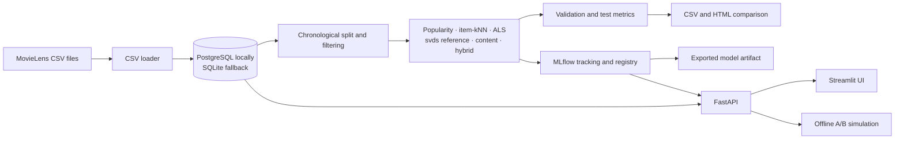

# MovieLens 25M Recommender System

A reproducible, classical-ML movie recommender built on the MovieLens 25M
dataset. It includes a chronological offline evaluation pipeline, MLflow
experiment tracking and model registration, an API, a Streamlit UI, and an
offline-simulated A/B testing module. No neural-network models are used.

## Architecture



## Requirements

- Python 3.13
- [`uv`](https://docs.astral.sh/uv/)
- Docker with Docker Compose for the local PostgreSQL/MLflow/API stack
- MovieLens 25M CSV files for loading and full training

## WSL setup

From Ubuntu/WSL, install `uv` if needed, then create the project environment:

```bash
curl -LsSf https://astral.sh/uv/install.sh | sh
export PATH="$HOME/.local/bin:$HOME/.cargo/bin:$PATH"

cd /home/sxsewvn/ForGitHubProjects/MovieRecSys
uv python install 3.13
uv venv --python 3.13 .venv
source .venv/bin/activate
python --version
```

Confirm that the version is Python 3.13. Install project and development
dependencies:

```bash
uv pip install -e ".[dev]"
```

The project currently has no `uv.lock`; use the command above unless a lockfile
is added later.

Put the six MovieLens CSVs in `data/` (or point `MOVIELENS_DATA_DIR` to their
directory): `ratings.csv`, `movies.csv`, `tags.csv`, `links.csv`,
`genome-scores.csv`, and `genome-tags.csv`. Raw data, generated databases, model
artifacts, and MLflow stores are ignored by Git.

## Run locally

Start the local PostgreSQL and MLflow services:

```bash
docker compose up -d postgres mlflow
```

Load the data (the Make target applies the Alembic migrations first):

```bash
make load-data
```

Run the configured training and evaluation pipeline:

```bash
make train
```

Training records validation and test metrics and model artifacts in MLflow.
The best model is selected using validation NDCG@10, then registered in the
MLflow Model Registry. Training is a full-data operation; use the bounded
synthetic smoke mode for a quick workflow check:

```bash
python -m recsys.training \
  --data-config configs/data.yaml \
  --model-config configs/models.yaml \
  --experiment-config configs/experiments.yaml \
  --smoke
```

To re-evaluate the exported model against the configured chronological test
split and compare the result with the saved model table:

```bash
python -m recsys.evaluation.best_model_check
```

By default, the script reads `outputs/best_model/model/`,
`outputs/model_metrics.csv`, and the MovieLens files under `data/`. It writes
`outputs/best_model_evaluation.json`. This check can take time and memory on
the full dataset. It uses the test split only for final diagnostics; do not
retune model selection based on test results.

Run the API and UI with Docker Compose when their services and local
configuration are ready:

```bash
docker compose up --build -d
```

The API Swagger UI is available at `http://localhost:8000/docs`; the default
Streamlit port is `http://localhost:8501`.

## Recorded offline results

The following values are from the checked-in-workspace artifact
`outputs/model_metrics.csv`. Ranking metrics are at 10. The NDCG gap is
validation NDCG@10 minus test NDCG@10; percentage drop is relative to
validation. This summarizes the saved run, not a new verification run.

| Model | Validation NDCG@10 | Test NDCG@10 | NDCG gap | Drop | Validation Recall@10 | Test Recall@10 | Validation MAP@10 | Test MAP@10 | Validation Precision@10 | Test Precision@10 |
|---|---:|---:|---:|---:|---:|---:|---:|---:|---:|---:|
| svds_reference | 0.1381 | 0.1058 | 0.0323 | 23.4% | 0.0586 | 0.0568 | 0.0753 | 0.0558 | 0.1186 | 0.0866 |
| hybrid | 0.1206 | 0.0908 | 0.0298 | 24.7% | 0.0526 | 0.0567 | 0.0603 | 0.0448 | 0.1020 | 0.0737 |
| item_knn | 0.1060 | 0.0845 | 0.0216 | 20.3% | 0.0423 | 0.0427 | 0.0555 | 0.0440 | 0.0937 | 0.0699 |
| popularity | 0.0755 | 0.0621 | 0.0134 | 17.8% | 0.0277 | 0.0308 | 0.0382 | 0.0311 | 0.0629 | 0.0502 |
| content_based | 0.0732 | 0.0535 | 0.0197 | 26.9% | 0.0357 | 0.0372 | 0.0309 | 0.0228 | 0.0700 | 0.0490 |
| als | 0.0004 | 0.0004 | -0.00002 | — | 0.0001 | 0.0001 | 0.0001 | 0.0001 | 0.0004 | 0.0004 |

`svds_reference` leads this recorded run on validation and test NDCG@10. Its
NDCG drops by about 23.4% from validation to test. The next step before relying
on the selected artifact is to run the independent exported-model evaluation
script and check that its recomputed test metrics match the logged metrics.

## Known limitations and open issues

- **ALS anomaly (open issue):** the recorded ALS NDCG@10 is approximately
  0.0004 on both validation and test, and its average recommendation popularity
  is approximately 42 training ratings. The root cause has not been identified
  yet; this README records the anomaly without asserting a cause. Treat ALS and
  results that combine ALS as untrusted until the issue is investigated.
- The reported offline test results use historical ratings as a proxy for
  future preference. They do not measure live user satisfaction or establish
  an online business impact.
- The A/B module is an offline simulation: a rating above the configured
  threshold in the test period is used as a click proxy. It is not a live
  experiment.
- The saved metrics are one historical run. Validation-to-test changes may
  reflect temporal preference drift and do not alone prove data leakage or
  statistical significance.
- Full MovieLens training and independent exported-model evaluation can require
  substantial memory and runtime. No hard memory ceiling is enforced.
- Model and result files under `outputs/`, `mlruns/`, and local database files
  are generated artifacts and are not source-controlled by default.
